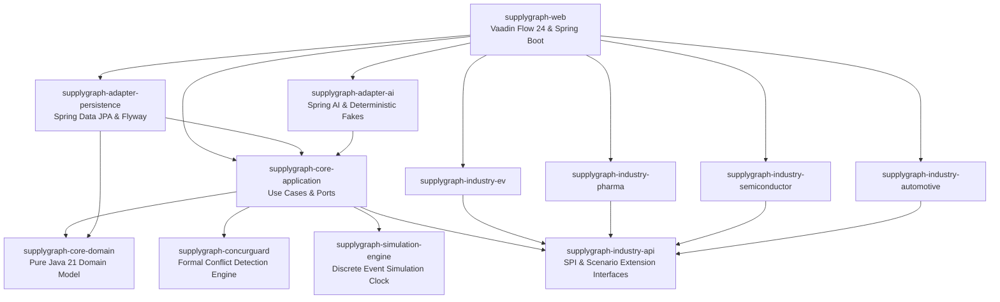

# SupplyGraph

> **Industry-Configurable Agentic Supply Chain Intelligence, Digital Twin & Conflict-Aware Recovery Platform**

SupplyGraph is a high-assurance, Java-first enterprise platform engineered to model multi-tier supply chain digital twins, detect cascading disruptions, orchestrate bounded specialist AI agents, arbitrate conflicting recovery plans deterministically via **ConcurGuard**, run what-if simulations, and deliver evidence-backed decision support for human operators.

---

## Architecture Overview

SupplyGraph is structured as a **modular monolith** with clean hexagonal boundaries, strict dependency inversion, and zero cyclic dependencies across 12 decoupled Maven modules.



### Module Responsibilities

| Module | Responsibility | Purity & Rules |
| :--- | :--- | :--- |
| [`supplygraph-core-domain`](file:///Users/abhinavgupta/Desktop/Supplygraph/supplygraph-core-domain) | Canonical domain entities, value objects, domain invariants, double-entry inventory ledger | **Pure Java 21**. Zero dependencies on Spring, JPA, Vaadin, Jackson, or AI frameworks. |
| [`supplygraph-industry-api`](file:///Users/abhinavgupta/Desktop/Supplygraph/supplygraph-industry-api) | Extensibility SPI contracts (`IndustryPackExtension`, `IndustryIdentifier`, `IndustryPolicy`) | Pure Java interface specifications for pluggable industry packs. |
| [`supplygraph-concurguard`](file:///Users/abhinavgupta/Desktop/Supplygraph/supplygraph-concurguard) | Formal conflict detection engine arbitrating across 7 deterministic conflict classes | Pure algorithmic Java logic. Evaluates claims, time windows, and invariants. |
| [`supplygraph-simulation-engine`](file:///Users/abhinavgupta/Desktop/Supplygraph/supplygraph-simulation-engine) | Discrete event simulation clock, Monte Carlo runners, and Google OR-Tools integration | High-performance deterministic simulation runtime. |
| [`supplygraph-core-application`](file:///Users/abhinavgupta/Desktop/Supplygraph/supplygraph-core-application) | Application services, use case interactors, input/output boundary ports | Orchestrates domain operations. Depends only on domain and engines. |
| [`supplygraph-industry-ev`](file:///Users/abhinavgupta/Desktop/Supplygraph/supplygraph-industry-ev) | EV Battery Manufacturing industry pack (8 industrial scenarios) | Implements `IndustryPackExtension`. Self-contained scenario definitions. |
| [`supplygraph-industry-pharma`](file:///Users/abhinavgupta/Desktop/Supplygraph/supplygraph-industry-pharma) | Pharmaceutical Supply Chain industry pack (8 industrial scenarios) | Implements `IndustryPackExtension`. Enforces cold-chain and GMP policies. |
| [`supplygraph-industry-semiconductor`](file:///Users/abhinavgupta/Desktop/Supplygraph/supplygraph-industry-semiconductor) | Semiconductor Manufacturing industry pack (8 industrial scenarios) | Implements `IndustryPackExtension`. High-mix fab capacity constraints. |
| [`supplygraph-industry-automotive`](file:///Users/abhinavgupta/Desktop/Supplygraph/supplygraph-industry-automotive) | Automotive Component Manufacturing industry pack (8 industrial scenarios) | Implements `IndustryPackExtension`. Just-in-Time/Just-in-Sequence rules. |
| [`supplygraph-adapter-persistence`](file:///Users/abhinavgupta/Desktop/Supplygraph/supplygraph-adapter-persistence) | PostgreSQL persistence adapter, Spring Data JPA repositories, Flyway schema migrations | Implements application persistence SPI ports against PostgreSQL 16+. |
| [`supplygraph-adapter-ai`](file:///Users/abhinavgupta/Desktop/Supplygraph/supplygraph-adapter-ai) | Spring AI integration, bounded prompt templates, deterministic test fakes | Implements AI gateway ports. Enforces JSON schemas and bounded retry logic. |
| [`supplygraph-web`](file:///Users/abhinavgupta/Desktop/Supplygraph/supplygraph-web) | Vaadin Flow 24 Java-authored UI, Spring Boot composition root, Actuator endpoints | Assembly root. No frontend build tools (Node.js/React) required. |

---

## Prerequisites

- **Java Development Kit:** OpenJDK 21 LTS (`<maven.compiler.release>21</maven.compiler.release>`)
- **Build Tool:** Apache Maven 3.9+ (bundled via `./mvnw` wrapper)
- **Container Runtime:** Docker 24+ / Colima (required for Testcontainers integration tests)
- **Database (Optional for local dev):** PostgreSQL 16+ (H2 PostgreSQL-compatibility mode included for zero-install dev)

---

## Quickstart

### 1. Build and Run Full Test Suite

Run the complete Maven build and verification across all 12 modules, including ArchUnit architecture enforcement and Testcontainers PostgreSQL migrations:

```bash
# Set Java 21 home
export JAVA_HOME=/opt/homebrew/opt/openjdk@21

# Run clean compile and test verification
./mvnw clean verify
```

### 2. Start PostgreSQL via Docker Compose

To launch the isolated PostgreSQL 16 database instance for SupplyGraph (configured on port `5433` to prevent local port collisions):

```bash
docker compose up -d
```

### 3. Run the Application

Launch the Spring Boot composition root:

```bash
./mvnw spring-boot:run -pl supplygraph-web
```

### 4. Access the Application

- **Vaadin Flow Navigation UI:** [http://localhost:8080/](http://localhost:8080/)
- **System Health View:** [http://localhost:8080/health](http://localhost:8080/health)
- **Spring Boot Actuator Health Probe:** [http://localhost:8080/actuator/health](http://localhost:8080/actuator/health)

---

## Architectural Guarantees & Verification Gates

SupplyGraph enforces strict structural quality via automated gates:

1. **ArchUnit Boundary Enforcement (`ArchitectureBoundaryTests`):**
   - Pure domain core cannot depend on Spring, JPA, Vaadin, Jackson, or AI frameworks.
   - Core application cannot depend on web presentation or database persistence adapters.
   - Web tier cannot bypass application ports to query persistence adapters directly.
   - Vaadin Flow UI classes are strictly confined to `supplygraph-web`.
2. **Database Schema Durability (`FlywayMigrationIntegrationTest`):**
   - Schema versioning verified via Testcontainers PostgreSQL 16 on every build.
3. **Deterministic Extensibility:**
   - Pluggable `IndustryPackExtension` SPI allows introducing new industry domains without modifying the platform core.

---

## Documentation Index

- [Development Setup Guide](file:///Users/abhinavgupta/Desktop/Supplygraph/docs/DEVELOPMENT_SETUP.md)
- [System Architecture](file:///Users/abhinavgupta/Desktop/Supplygraph/docs/ARCHITECTURE.md)
- [Maven Module Catalog](file:///Users/abhinavgupta/Desktop/Supplygraph/docs/MAVEN_MODULES.md)
- [Database Setup & Migrations](file:///Users/abhinavgupta/Desktop/Supplygraph/docs/DATABASE_SETUP.md)
- [Testing & Quality Guide](file:///Users/abhinavgupta/Desktop/Supplygraph/docs/TESTING_GUIDE.md)
- [Phase 1 Completion Report](file:///Users/abhinavgupta/Desktop/Supplygraph/docs/PHASE_1_COMPLETION_REPORT.md)
- [Engineering Review & ADRs](file:///Users/abhinavgupta/Desktop/Supplygraph/engineering-review/FINAL_ARCHITECTURE_DECISIONS.md)
