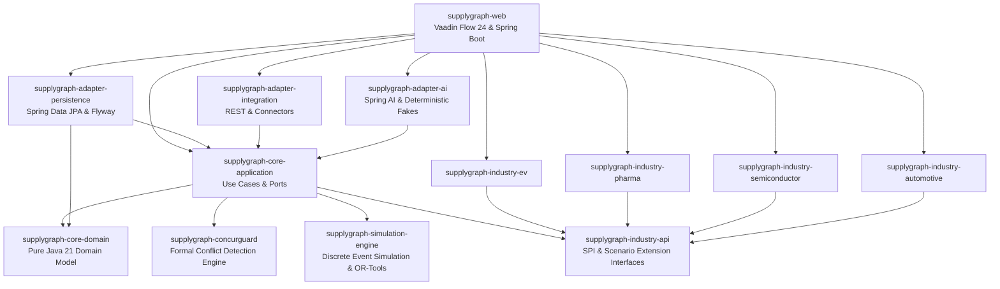

# SupplyGraph

> **Industry-Configurable Agentic Supply Chain Intelligence, Digital Twin & Conflict-Aware Recovery Platform**

SupplyGraph is a high-assurance, Java-first enterprise platform engineered to model multi-tier supply chain digital twins, detect cascading disruptions, orchestrate bounded specialist AI agents, arbitrate conflicting recovery plans deterministically via **ConcurGuard**, run what-if simulations, optimize multi-echelon inventory and recovery networks via Google OR-Tools, enforce greenhouse gas sustainability and product traceability, manage supplier collaboration, and deliver role-specific cockpits for enterprise operators.

---

## Architecture Overview

SupplyGraph is structured as a **modular monolith** with clean hexagonal boundaries, strict dependency inversion, and zero cyclic dependencies across 14 decoupled Maven modules.



---

## Module Responsibilities

| Module | Responsibility | Purity & Architectural Rules |
| :--- | :--- | :--- |
| [`supplygraph-core-domain`](supplygraph-core-domain) | Canonical domain entities, value objects, domain invariants, double-entry inventory ledger | **Pure Java 21**. Zero dependencies on Spring, JPA, Vaadin, Jackson, or AI frameworks. |
| [`supplygraph-industry-api`](supplygraph-industry-api) | Extensibility SPI contracts (`IndustryPackExtension`, `IndustryIdentifier`, `IndustryPolicy`) | Pure Java interface specifications for pluggable industry packs. |
| [`supplygraph-concurguard`](supplygraph-concurguard) | Formal conflict detection engine arbitrating across 7 deterministic conflict classes | Pure algorithmic Java logic. Evaluates claims, time windows, and invariants. |
| [`supplygraph-simulation-engine`](supplygraph-simulation-engine) | Discrete event simulation clock, Monte Carlo runners, and Google OR-Tools integration | High-performance deterministic simulation runtime and MIP solvers. |
| [`supplygraph-core-application`](supplygraph-core-application) | Application services, use case interactors, input/output boundary ports | Orchestrates domain operations. Depends only on domain and engines. |
| [`supplygraph-industry-ev`](supplygraph-industry-ev) | EV Battery Manufacturing industry pack | Implements `IndustryPackExtension`. Self-contained scenario definitions. |
| [`supplygraph-industry-pharma`](supplygraph-industry-pharma) | Pharmaceutical Supply Chain industry pack | Implements `IndustryPackExtension`. Enforces cold-chain and GMP policies. |
| [`supplygraph-industry-semiconductor`](supplygraph-industry-semiconductor) | Semiconductor Manufacturing industry pack | Implements `IndustryPackExtension`. High-mix fab capacity constraints. |
| [`supplygraph-industry-automotive`](supplygraph-industry-automotive) | Automotive Component Manufacturing industry pack | Implements `IndustryPackExtension`. Just-in-Time/Just-in-Sequence rules. |
| [`supplygraph-adapter-persistence`](supplygraph-adapter-persistence) | PostgreSQL persistence adapter, Spring Data JPA repositories, Flyway migrations | Implements application persistence SPI ports against PostgreSQL 16+. |
| [`supplygraph-adapter-integration`](supplygraph-adapter-integration) | Integration runtime, bidirectional connectors, outbox/inbox, SSRF-safe REST | Implements enterprise ingestion, external webhooks, and sync engine. |
| [`supplygraph-adapter-ai`](supplygraph-adapter-ai) | Spring AI integration, bounded prompt templates, deterministic test fakes | Implements AI gateway ports. Enforces JSON schemas and bounded retry logic. |
| [`supplygraph-web`](supplygraph-web) | Vaadin Flow 24 Java-authored UI, Spring Boot composition root, Actuator endpoints | Assembly root. No frontend build tools (Node.js/React) required. |

---

## Roadmap Phases (1 through 15)

- **Phase 1: Modular Foundation & Architecture:** Maven multi-module parent POM, ArchUnit architectural tests, Spring Boot 3.4.1, Vaadin Flow 24.5.4, PostgreSQL 16+, and Flyway schema migrations.
- **Phase 2: Digital Twin Core & Graph Domain:** Canonical directed supply chain graph, multi-tier BOM explosion DAG, double-entry inventory ledger, capacity calendars, and immutable snapshots.
- **Phase 3: Agentic AI Orchestration & ConcurGuard:** Disruption investigation agents, inventory, procurement, and logistics replanning, and the ConcurGuard conflict arbitration engine arbitrating 7 conflict classes.
- **Phase 4: Simulation, Monte Carlo & Mathematical Optimization:** Discrete-event simulation, Monte Carlo risk engine (P10, P50, P90), Google OR-Tools MIP solver, and audited recovery approvals.
- **Phase 5: Continuous Intelligence & Outbox-Driven Replanning:** Transactional Outbox pattern on PostgreSQL, real-time event ingestion, and dynamic drift-triggered replanning.
- **Phase 6: Enterprise Security, RBAC & Multi-Tenancy:** Role-Based Access Control (9 roles), tenant isolation boundaries, and cryptographically verified SHA-256 immutable audit logging.
- **Phase 7: Pluggable Industry Packs & Advanced Decision Intelligence:** Decoupled SPI architecture with 4 packs (EV Battery, Semiconductor, Aerospace, Pharma), multi-objective Pareto frontiers, XAI attribution, and decision provenance graphs.
- **Phase 8: Enterprise Integration & Data Quality:** High-throughput CSV/JSON ingestion pipelines, schema validation, domain invariant checking, and staged preview quarantine.
- **Phase 9: Integration Runtime & Bidirectional Connectors:** Connector lifecycle management (`DRAFT`, `ACTIVE`, `PAUSED`, `ERROR`), HMAC webhooks, SSRF-guarded REST adapter, and field-level reconciliation.
- **Phase 10: Governed Recovery Task Graphs & Execution:** DAG task graphs with cycle detection, Separation of Duties (SoD) multi-party approvals, and closed-loop plan-versus-actual variance tracking.
- **Phase 11: Multi-Echelon Planning (MEIO) & Inventory Optimization:** Multi-Echelon Inventory Optimization, stochastic safety stock calculations, dynamic reorder points, demand forecasting, and 15 Vaadin planning views.
- **Phase 12: Sustainability, ESG & Product Traceability:** Scope 1-3 GHG carbon accounting, Product Genealogy DAG (`ArrayDeque` blast-radius traversal), supplier ESG scorecards, circular economy ledger, and 12 Vaadin sustainability views.
- **Phase 13: Supplier Collaboration & Partner Ecosystem:** Multi-tier Supplier Portal, RFQ management and bidding, purchase order acknowledgment, Advance Shipping Notices (ASN), 8D quality investigations, and cryptographic document vault with 14 Vaadin views.
- **Phase 14: Premium Enterprise UI/UX & Persona Cockpits:** Enterprise design system with CSS tokens, elevation shadows, and status badges, 9 role-specific persona workspaces, and a Unified Enterprise Command Centre with universal cross-domain search.
- **Phase 15: Enterprise Platform Maturity & Governance:** Multi-tenant resource quotas, versioned industry configuration policies with automated deprecation and 1-click rollback, scoped API developer centre, disaster recovery snapshot vault, and real-time JVM/pool telemetry with 13 administrative views.

---

## Technology Stack

- **Runtime:** Java 21 LTS (OpenJDK 64-Bit Server VM)
- **Framework:** Spring Boot 3.4.1
- **UI Platform:** Vaadin Flow 24.5.4 (100% Java-authored, zero Node.js/React runtime)
- **Database:** PostgreSQL 16+ (Flyway forward migrations v1 through v15)
- **Optimization:** Google OR-Tools 9.11.4210 (MIP/LP mathematical solver)
- **Testing:** JUnit 5, AssertJ, Mockito, Testcontainers (PostgreSQL 16), ArchUnit

---

## Quickstart & Verification

### Prerequisites
- OpenJDK 21 LTS (`JAVA_HOME=/opt/homebrew/opt/openjdk@21`)
- Docker / Colima (for Testcontainers PostgreSQL tests)
- Apache Maven 3.9+ (bundled via `./mvnw`)

### Running the Full Test Suite
```bash
export JAVA_HOME=/opt/homebrew/opt/openjdk@21
export DOCKER_HOST="unix:///Users/abhinavgupta/.colima/default/docker.sock"
export TESTCONTAINERS_RYUK_DISABLED="true"

./mvnw clean test
```

### Starting the Application
```bash
./mvnw -pl supplygraph-web spring-boot:run
```
Access the application at `http://localhost:8080/`. Default role credentials and workspace context are provisioned via demo initializers for instant exploration.
