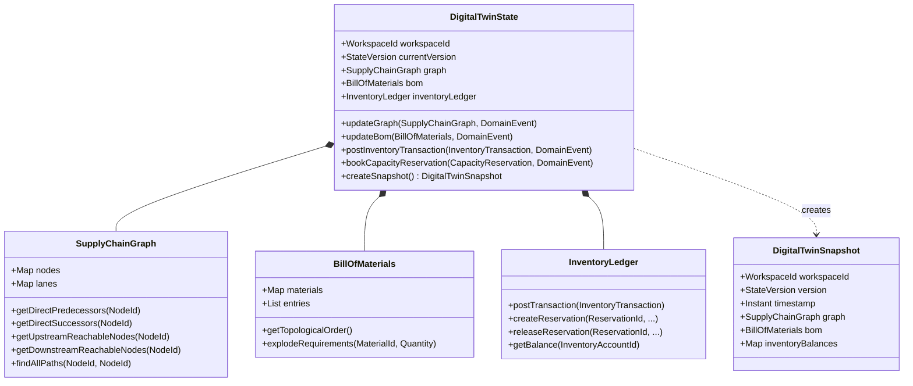

# SupplyGraph — Digital Twin Domain Model Specification

**Document ID:** `SG-SPEC-001`  
**Phase:** Phase 2 (Digital Twin Core & Graph Domain Model)  
**Status:** Approved Engineering Specification  

---

## 1. Domain Overview

The SupplyGraph Digital Twin provides a high-assurance, version-controlled, in-memory aggregate representation of multi-tier supply chain physical topology, operational schedules, inventory positions, and material dependencies.

---

## 2. Canonical Supply Chain Network Graph

### 2.1 Nodes (`SupplyChainNode`)
All nodes share invariant properties (`NodeId`, `name`, `NodeType`, `location`, `active` status) and specialize into:

1. **`Supplier`:** Multi-tier vendor (`tier >= 1`), quality certifications (`Set<String>`), and normalized risk score ($[0.0, 1.0]$).
2. **`ManufacturingSite`:** Industrial fabrication facility with designated production lines, cleanroom standard classification (e.g., ISO-5, ISO-7), and maximum nominal hourly unit throughput.
3. **`Warehouse`:** Storage facility with square-meter storage footprint, cold-chain refrigeration capability flag, and hazardous material authorization flag.
4. **`LogisticsHub`:** Transshipment and intermodal hub supporting cross-docking, daily pallet throughput capacity, and freight modes (ROAD, AIR, OCEAN, RAIL, INTERMODAL).

### 2.2 Directed Transportation Lanes (`TransportationLane`)
Edges connect a source node to a target node:
- **No Self-Loops:** `sourceNodeId != targetNodeId`.
- **Nominal Transit Duration:** Deterministic temporal duration (`java.time.Duration`).
- **Freight Cost Rate:** `BigDecimal costPerKg` (scale 4).
- **Operational Status:** Boolean flag indicating whether the lane is currently passable or disrupted.

---

## 3. Resource Capacity & Operating Schedules

Resources (machines, inspection stations, cleanroom lines) are bounded by time-dependent capacity:
- **Half-Open Windows $[start, end)$:**
  - $t \in [start, end) \iff start \le t < end$.
  - Two adjacent windows $[10:00, 12:00)$ and $[12:00, 14:00)$ have empty intersection (zero overlap).
- **Capacity Rates:** Unit throughput per hour (e.g. `WAFER/HOUR`, `HOUR/HOUR`).
- **Availability Computation:**
  $$\text{AvailableCapacity}(W) = \max\left(0, \text{Rate} \times \text{Duration}(W) - \sum_{r \in \text{Overlapping}} r.\text{quantity}\right)$$

---

## 4. State Versioning & Monotonic State Progression

1. **Monotonic Version Counter:**
   - Every state mutation increments `currentVersion` by 1: $v_{i+1} = v_i + 1$.
   - Version values are strictly non-negative and sequential.
2. **Event Deduplication:**
   - Every domain mutation is triggered by a `DomainEvent(eventId, eventType, timestamp, payload)`.
   - `DigitalTwinState` maintains a set of processed event IDs.
   - If an incoming event ID has already been applied, the transition is skipped, ensuring idempotent event replay.
3. **Snapshot Isolation:**
   - `createSnapshot()` creates an immutable `DigitalTwinSnapshot`.
   - Simulation engines and what-if optimizers operate on cloned snapshots, guaranteeing that speculative branches cannot corrupt authoritative production state.

