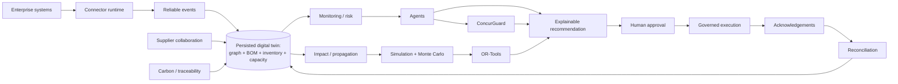
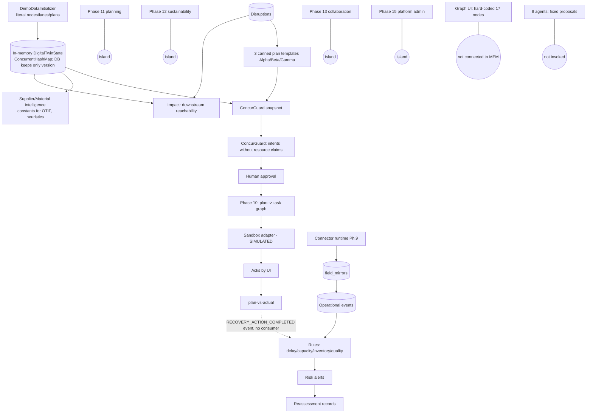

# SupplyGraph — Actual Architecture (as inspected, 2026-11-18)

## 1. Structure
Java 21 modular monolith, 13 Maven modules (+ parent), Spring Boot 3.4.1, Vaadin 24.5.4, Flyway V1–V15, hexagonal boundaries enforced by ArchUnit (clean: domain has no framework imports; web uses services, not entities). Source size: core-domain 266 classes, core-application 166, persistence 172, web 143, others small. ≈441 `@Test` methods.

The layering is genuinely good. The problem is not module hygiene; it is **what flows through the modules**.

## 2. Intended data flow (vision)

## 3. Actual data flow (as found)

## 4. Findings on integration (evidence in `SUPPLYGRAPH_INTENDED_VS_ACTUAL.md`)

| Question | Finding |
|---|---|
| Is the digital twin the common source of truth? | No. It exists only in JVM memory (re-seeded every start); the DB holds a version number. Phase 11–15 modules do not read it at all. |
| Does the graph use real domain entities? | The domain graph does; the **visualization does not** (literals). |
| Do agents get graph/operational context? | Agents receive an `AgentInvestigationContext` but ignore tool results and return constants; the orchestrator is not called by any view. |
| Are agents coherent with each other? | Their ids/targets are derived from `affectedNodeIds.findFirst()`; there is no shared reasoning. |
| Does ConcurGuard validate actual proposed actions? | It validates plan actions, but intents carry no resource/capacity claims, so most detectors have nothing to evaluate. |
| Does simulation consume real scenario inputs? | Engines are real; inputs come from forms/parameters. Link to the twin graph not verified here. |
| Does optimization use valid constraints? | Real LP (demand fulfilment, capacities, unmet penalty); candidate set is hard-coded in the view. |
| Do recovery plans connect to execution? | **Yes** (Phase 10) — approved plan → workflow → tasks. |
| Do execution outcomes update the twin? | **No.** They emit `RECOVERY_ACTION_COMPLETED` operational events that no monitoring rule consumes; the twin graph/ledger is never mutated. |
| Does monitoring learn from outcomes? | No learning loop exists. Closed-loop produces comparison and human-decided proposals only. |
| Does supplier collaboration affect operations? | No path from RFQ/orders/quality/portal to plans, tasks or risk. |
| Do integration events update the right domain records? | They update the **integration mirror** and raise operational events; imports (Phase 7) do not touch the twin (repository injected, unused). |
| Do sustainability/traceability connect to material/product genealogy? | Their own genealogy tables; no link to twin materials, BOM or inventory lots. |

### Duplicate sources of truth
1. **Workspace identity**: Phase 1–6 views use `WS-AUTO-01`; Phase 7+ views use the string `"default-workspace"` (≈25 literal uses). `DemoDataInitializer` seeds both. Visible symptoms: Home shows 2 active disruptions, Executive Workspace shows 0, Global Search for "Munich" returns nothing.
2. **Network topology**: seeded twin (`DemoDataInitializer`), graph component literals, explorer table literals — three copies.
3. **Recovery options**: `generateAlternativePlans` templates, Home page text (different options), `OptimizationWorkspaceView` candidates (third set), `DemoDataInitializer` explainable candidate (fourth).
4. **Disruption state in the graph**: constants vs `Disruption` aggregate.

## 5. Route inventory (128 `@Route`s; captured from the running app's route list)

| Area | Routes | Count |
|---|---|---|
| Core intelligence (Phases 2–8) | `/`, `digital-twin`, `disruptions`, `impact`, `simulation`, `monte-carlo`, `optimization`, `decision-centre`, `events`, `event-ingestion`, `monitoring-rules`, `risk-alerts`, `reassessments`, `adaptive-replanning`, `agent-history`, `data-integration`, `import-history`, `import-preview`, `data-quality`, `supplier-intelligence`, `supplier-dependencies`, `material-criticality`, `inventory-intelligence`, `industry-config`, `resilience-analytics`, `security-admin`, `audit-log`, `provenance`, `benchmark-studio`, `benchmark-dashboard`, `statistical-results`, `recommendations-explainable`, `decision-provenance`, `what-if-workspace`, `pareto-comparison`, `sensitivity-analysis`, `advanced-resilience`, `experiment-manager`, `decision-intelligence`, `health` | ≈41 |
| Integration runtime (Phase 9) | `integration-centre`, `connectors`, `connector-config`, `connector-health`, `synchronization`, `sync-history`, `event-delivery`, `dead-letters`, `event-replay`, `reconciliation`, `integration-security`, `runtime-operations` | 12 |
| Governed execution (Phase 10) | `execution-centre`, `execution-designer`, `execution-approvals`, `task-dependencies`, `execution-monitor`, `execution-failures`, `execution-acknowledgements`, `execution-reconciliation`, `execution-compensation`, `execution-timeline`, `plan-vs-actual`, `closed-loop` | 12 |
| Planning (Phase 11) | `planning`, `planning/demand(+detail,+forecasts)`, `planning/inventory(+reorder,+safety-stock)`, `planning/procurement(+allocation)`, `planning/production(+capacity)`, `planning/network`, `planning/scenarios(+results)`, `planning/approval` | 15 |
| Sustainability (Phase 12) | `sustainability`, `carbon`, `carbon/manufacturing`, `carbon/transport`, `circular`, `esg`, `evidence`, `scenarios`, `traceability/{genealogy,lots,origin,recall}` | 12 |
| Collaboration (Phase 13) | `collaboration/{activity,documents,quality,rfq,rfq/compare,suppliers}`, `portal`, `portal/{capacity,deliveries,evidence,orders,organization,profile,rfq/submit}` | 14 |
| Experience (Phase 14) | `command-center`, `workspace/{executive,planner,procurement,production,logistics,quality,analyst,supplier,admin}` | 10 |
| Platform admin (Phase 15) | `admin/{api,audit,backup,enterprise,extensions,health,industry-policies(+diff,+history),performance,users,version,workspaces}` | 12 |

The left navigation presents ≈50 top-level entries plus expandable groups; it mirrors the *module* structure and the *phase* history rather than user tasks.

## 6. Cross-cutting
* **Security**: server-side permission and workspace checks exist in Phase 9/10 services and `WorkspaceAccessGuard`; there is **no authentication**. The UI principal is a configured operator (my `UiPrincipalFilter`) with a demo role switcher; only 10 classes in `core-application` reference `WorkspaceAccessGuard` (audit, provenance, user management, and the Phase 9/10 services). **The Phase 4–8 services and all of the Phase 11–15 services (planning, sustainability, collaboration, platform administration, API keys, backup) perform no server-side permission or workspace check**, so RBAC and tenant isolation are not enforced for most of the product, including the "Enterprise Platform" admin features. The Vaadin app runs in dev mode (frontend toolchain at runtime) and there is no production bundle build.
* **Reliability**: outbox/inbox, bounded execution, restart recovery are real (Phases 9–10, PostgreSQL-tested). The twin is the weakest link for durability.
* **Testing**: strong at unit/slice level; the tests mostly assert the modules in isolation, which is why "443 passing tests" coexisted with a fictional graph and fixed agents. There is no test that asserts "changing the twin changes the graph page" or "an agent's output depends on its input".
* **Environment**: JDK 21 required (JDK 26 breaks Mockito); the working tree is concurrently modified; Phase 11–15 code is uncommitted.
