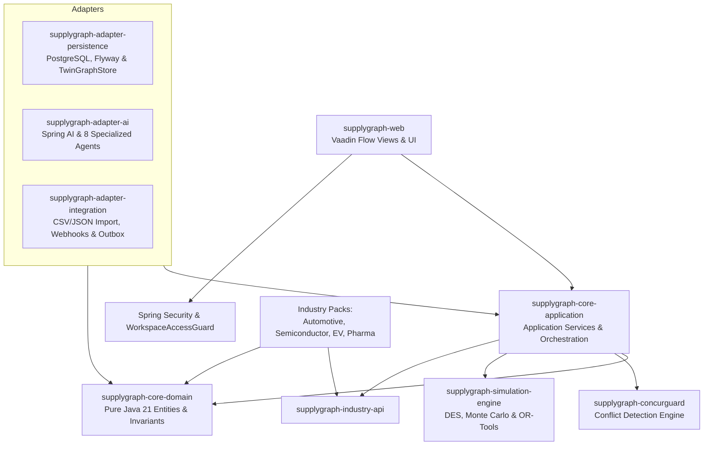
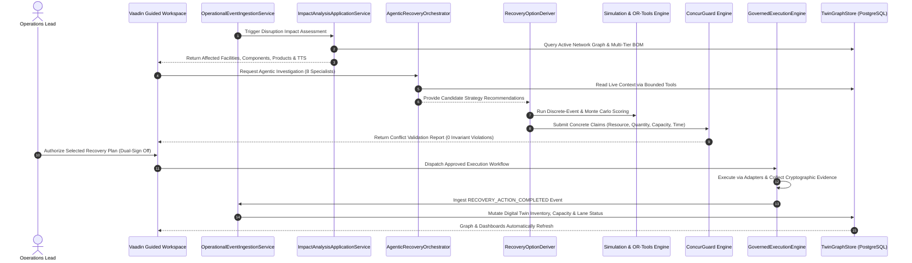

# SupplyGraph — Target Architecture & System Blueprint

**Document Version:** 2.0 (Post-Realignment)  
**System Classification:** Single-Tenant / Multi-Workspace Modular Monolith  
**Core Technologies:** Java 21 LTS, Spring Boot 3.4.1, Vaadin Flow 24.5.4, PostgreSQL 16, Google OR-Tools, Flyway

---

## 1. Architectural Philosophy & Principles

SupplyGraph is designed under strict hexagonal architecture and domain-driven design principles:
1. **Single Common Operational Truth:** The persisted Digital Twin (`TwinGraphStore` in PostgreSQL V2 tables) is the sole authoritative state of the supply chain network, BOM, capacities, and inventory balances.
2. **Pure Java 21 Domain:** `supplygraph-core-domain` contains 100% pure Java 21 standard library code with zero dependencies on Spring, Vaadin, persistence frameworks, or cloud SDKs.
3. **Deterministic Authority over AI:** AI agents propose recovery actions; deterministic policy, simulation, and ConcurGuard validate invariants; authorized human operators approve; governed execution state machines enact changes.
4. **Closed-Loop Reconciliation:** Verified operational outcomes must mutate the living digital twin to close the loop between planning and reality.
5. **No Invented Metrics:** If data is missing or unmeasured, the UI must explicitly state `No data` and explain what is required.

---

## 2. Module Boundary Architecture

---

## 3. End-to-End Operational Lifecycle Pipeline

---

## 4. Security & Multi-Workspace Isolation Architecture

1. **Authentication:**
   - Spring Security form-based login for local/on-premise environments, OIDC/OAuth2 resource provider for enterprise SSO.
   - Session management with CSRF protection and secure HTTP-only cookies.
2. **Authorization & Workspace Scope:**
   - Every public application service method is guarded by `WorkspaceAccessGuard.checkAccess(workspaceId)`.
   - Workspace ownership is resolved directly from the authenticated `SecurityContext.getCurrentUser()`.
   - Cross-workspace queries and mutations are blocked with explicit `AccessDeniedException` and security audit logging.
3. **Separation of Duties (SoD):**
   - High-severity incident recovery plans require explicit segregation: the user creating or proposing an action cannot be the sole approver.
   - Dual-authorization threshold enforced for actions exceeding critical cost or capacity bounds.

---

## 5. Persistence & Flyway Strategy

- **Database:** PostgreSQL 16+ (H2 in-memory reserved strictly for isolated local unit tests).
- **Schema Management:** Flyway migrations V1 through V16, providing immutable relational structures for:
  - Workspaces, Users, Roles, Audit Logs
  - `supply_chain_nodes`, `transportation_lanes`, `materials`, `bom_entries`, `inventory_balances` (V2 tables managed via `TwinGraphStore`)
  - Disruption incidents, impact assessments, recovery plans, execution tasks
  - Continuous monitoring rules, alerts, and outbox telemetry events
  - Planning scenarios, partner collaboration records, ESG and traceability tables

