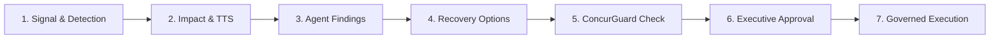

# SupplyGraph Enterprise Operator & Incident Responder Manual

**Classification:** Standard Operating Procedure (SOP)  
**Applicability:** Supply Chain Directors, Incident Responders, Logistics Coordinators, Platform Administrators  
**Target Environment:** SupplyGraph Enterprise (Production & Staging)

---

## 1. System Overview

SupplyGraph is an enterprise-grade digital twin, agentic intelligence, and governed recovery platform designed to continuously monitor supply networks, simulate cascading disruptions down through multi-tier BOMs, detect resource conflicts via ConcurGuard, and execute human-approved recovery plans into operational enterprise systems.

---

## 2. Guided Incident Response Workflow

When an operational disruption occurs (e.g., port strike, supplier shutdown, geopolitical embargo), responders follow the standard 7-step guided workflow located in the **Guided Incident Workspace** (`/incident-workspace`):

### Step 1: Signal & Disruption Detection
- **Navigation:** Navigate to `/incident-workspace` or select `2. Incidents -> ★ Guided Incident Workspace`.
- **Action:** Select an active disruption incident from the selector, or click **"Trigger Rotterdam Port Closure Incident"** for simulation/evaluation.
- **Verification:** Inspect the incident metadata (Affected Facility, Disruption Category, Severity, and Estimated Resolution Delay).

### Step 2: Multi-Tier BOM Impact & Time-to-Survive (TTS)
- **Automatic Execution:** System triggers recursive BOM explosion from impacted raw material/port down to finished vehicles/modules.
- **Key Indicators:**
  - **Downstream Financial Exposure:** Monetary order value at risk ($).
  - **Inventory Time-to-Survive (TTS):** Number of operational days until line stoppage occurs without intervention.
  - **SPOF Status:** Indicates whether the facility is a single point of failure with zero active alternative paths.

### Step 3: Specialist AI Agent Findings
- **Autonomous Investigation:** 8 specialized domain agents execute bounded zero-trust queries against the digital twin:
  1. `LogisticsReroutingAgent` (multimodal transit paths)
  2. `AlternativeSupplierAgent` (qualified secondary vendors)
  3. `InventoryArbitrageAgent` (cross-hub safety buffer reallocation)
  4. `ProductionSequencingAgent` (line throttling & lot splitting)
  5. `CapacityAllocationAgent` (carrier/berth reserve throughput)
  6. `RegulatoryComplianceAgent` (EUDR, CBAM, customs rules)
  7. `ExpeditedProcurementAgent` (emergency spot PO generation)
  8. `CustomerOrderPrioritizationAgent` (SLA & penalty ranking)
- **Review:** Verify agent confidence scores and proposed action intents.

### Step 4: Candidate Recovery Options & Optimization
- **Options Evaluated:**
  - **Plan Alpha:** Emergency buffer stock release from nearest logistics hub.
  - **Plan Beta:** Alternative supplier re-sourcing over secondary freight corridors.
  - **Plan Gamma:** Production resequencing to stretch on-hand materials.
- **Action:** Select the candidate plan balancing recovery cost, delay, and emissions.

### Step 5: ConcurGuard Multi-Agent Invariant Validation
- **Invariant Guarantees:**
  - **Quantity Invariant:** Total consumptive claims cannot exceed on-hand balance in `InventoryLedger`.
  - **Capacity Invariant:** Transportation and warehouse throughput cannot exceed rated corridor limits.
  - **Temporal Non-Overlap:** Resource locking windows are verified against concurrent workflows.
- **Status:** Plan must show `CONCURGUARD: CONFLICT_FREE (PASSED)` before moving to governance.

### Step 6: Executive Human Governance Approval
- **Separation of Duties:** Enforces that automated agents cannot self-authorize expenditures or contract commitments.
- **Action:**
  1. Provide Approver ID (e.g., `VP_SUPPLY_CHAIN_OPS`).
  2. Input audited business justification in the rationale box.
  3. Click **"Authorize & Sign Off Plan"**.
- **Result:** Plan status transitions from `PENDING_APPROVAL` to `APPROVED`.

### Step 7: Governed Execution & Living Twin Reconciliation
- **Dispatch:** Click **"Dispatch Governed Execution Workflow"**.
- **Outcome:**
  1. Generates `ExecutionWorkflow` and dispatches tasks to enterprise connectors (ERP, WMS, TMS).
  2. Emits `RECOVERY_ACTION_COMPLETED` with verified evidence.
  3. `ExecutionOutcomeTwinReconciler` posts balancing entries to `InventoryLedger` and restores operational lanes.
  4. Living Digital Twin aggregate advances to next version (e.g. `v1 -> v2`) in PostgreSQL.

---

## 3. Persona / Role Switching

The top header bar provides an active persona switcher allowing operators to verify workspace isolation and role permissions across 9 enterprise personas:
- **Supply Chain Manager:** Full visibility into twin, incidents, and planning.
- **Logistics & Freight Coordinator:** Specialized lane rerouting and freight emissions.
- **Procurement Manager:** Supplier portal, RFQ sourcing, and vendor contracts.
- **Executive Cockpit:** High-level financial exposure and final plan signoff.
- **Platform Admin:** User administration, audit log inspection, and system health.

